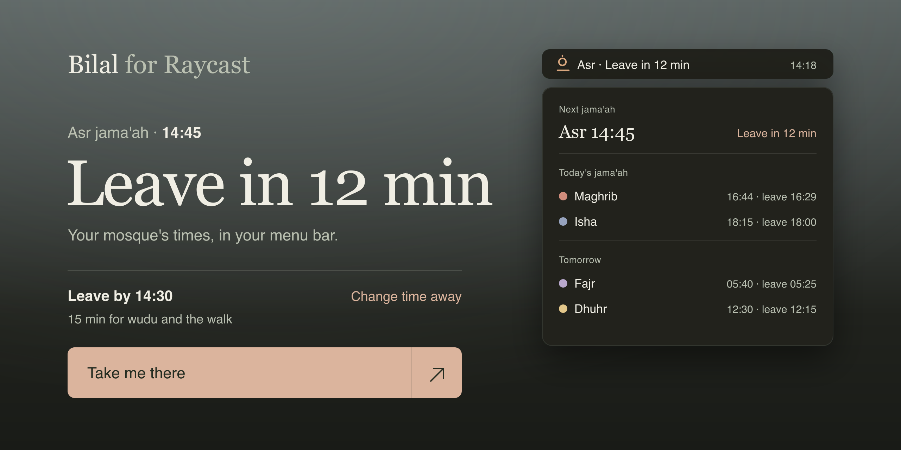

<p align="center">
  
</p>

<p align="center">
  <a href="LICENSE"></a>
  
  
</p>

An unofficial Raycast companion for [Bilal](https://bilalathan.co.uk). Pick your mosque once and the menu bar tells you when to leave, counting back from the jama'ah with time for wudu and the walk.

## Screenshots

| Menu bar                                                         | Next Jama'ah                                             |
| ---------------------------------------------------------------- | -------------------------------------------------------- |
|  |  |


## What it does

- **Jama'ah Countdown** lives in the menu bar: `Asr · Leave in 12 min`, then `Time to go` when it's time.
- **Next Jama'ah** lists the coming days, with a filter by prayer and a details pane (⌘D).
- Each prayer gets its own icon and colour, from Fajr's first light to Isha's night.
- **Take me there** opens directions to your mosque.
- If you're offline, it shows the last timetable it downloaded.

## Setup

1. Open [bilalathan.co.uk/calendar](https://bilalathan.co.uk/calendar) and pick your mosque and prayers.
2. Choose **Copy the calendar link**.
3. Paste it into the extension's **Calendar Link** preference.

Only the prayers in your link show up. Missing Isha? Tick it on the calendar page and copy the link again.

## Preferences

| Preference     | What it does                                                      |
| -------------- | ----------------------------------------------------------------- |
| Calendar Link  | Your mosque's calendar from bilalathan.co.uk/calendar             |
| Time Away      | Minutes for wudu and walking there, counted back from the jama'ah |
| Menu Bar Title | Prayer and countdown, or the countdown on its own                 |

## Privacy

Your calendar link stays on your Mac. The extension downloads your mosque's timetable from Bilal and nothing else. There's no account and no tracking.

## Development

```sh
npm install
npm run dev     # opens the extension in Raycast
npm test        # vitest
npm run lint
```

Code lives in `src/`. The calendar parser (`ics.ts`) and schedule maths (`schedule.ts`) are plain TypeScript with tests next to them; the Raycast views are `menu-bar.tsx` and `next-jamaah.tsx`.

Contributions are welcome. See [CONTRIBUTING.md](CONTRIBUTING.md).

## Credits

Jama'ah times come from [Bilal](https://bilalathan.co.uk), an independent jama'ah-time service. Please confirm any changes with your mosque. This extension isn't affiliated with Bilal.

## License

[MIT](LICENSE)
